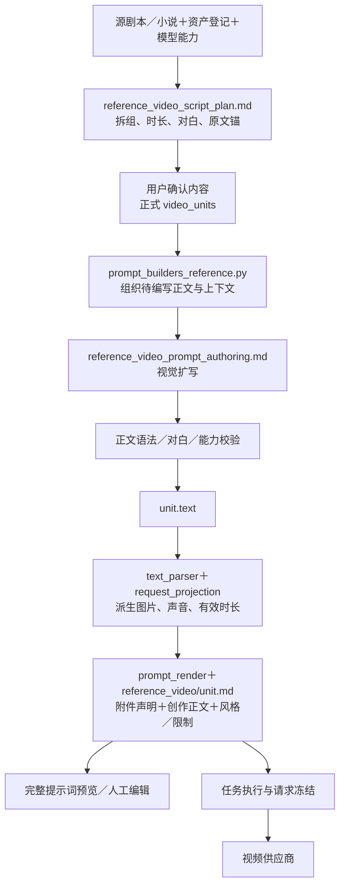

# XM_Studio 与巨日禄参考生视频框架对比

调查日期：2026-11-05。项目基于当前工作区，包含已有未提交修改；本文为源码调查与优化建议，未修改产品逻辑、未调用生成模型。

样例来源：[飞书《提示词架构》](https://my.feishu.cn/wiki/VvoAwQh3hiMDxVkiZ24cqYTXnMp)。巨日禄部分依据本会话已读取的剧本、顺序排列的 1—5 组提示词及四张参考图。页面标注的是“视频1使用图片”，不足以证明五组分别使用了哪些附件；本文也不把提示词设计等同于成片效果验证。

## 1. 结论

XM_Studio 的现有分层适合继续优化：拆解确定内容契约，编写补足视觉表达，程序负责附件和请求。主要缺口在导演编排与上下文传递，不能只修改 `reference_video/unit.md` 解决。

最值得从巨日禄吸收的是：按戏剧变化拆组、组内按时间组织镜头、跨组传递明确动作状态、让关键道具在离开画面后仍保有叙事连续性。项目已有对白保真、合法时长、图像与音色绑定、角度图和预览机制，应保留这些能力。

优先处理五件事：

1. 单条／部分重写时补充相邻单元的只读上下文，这是已确认的输入缺口。
2. 把“景别→构图→运镜→画面内容”由整组总述，升级为每个必要镜头／动作段的表达；显式写开场承接与收尾状态。
3. 调整拆组优先级：合法时长和对白可读时长是硬边界，戏剧节拍和动作切点优先于贴近最长档。
4. 消除“静态外观不能写”与“剧情状态必须交代”的冲突，并处理参考图与剧本起始状态不一致。
5. 在保留当前正文单一真相的前提下增加检查；不先建立第二套持久化镜头数组或状态表。

## 2. 实际链路



一个 `video_unit` 对应一次视频调用，不天然等于一个摄影镜头。巨日禄五组中的每组也包含多个时间段，因此适合映射为“单元内有若干必要镜头／动作段”，不能把每个时间段都强制变成独立生成任务。

当前提示词编写输入只有选中单元的“序号＋时长＋正文”，以及项目概述、风格、资产外观文字等。它没有直接拿到参考图片，也没有在局部重写时得到相邻组。输入投影会从 1 重新编号；模型看到的相邻选中项未必是原脚本中的相邻项。

## 3. 核心文件及职责

下表列影响本次比较的主文件。后文附三份主模板的完整递归片段清单、资产模板依赖、调用与验证文件清单。

| 文件 | 当前职责 | 优化重点 |
|---|---|---|
| [text/reference_video_script_plan.md](../../lib/prompts/prompt_templates/templates/text/reference_video_script_plan.md:40) | 拆分 unit，确定时长、台词、资产、source_text | 增加叙事节拍与动作切点优先级；不要一味贴近最长档 |
| [unit_rule/screenplay.md](../../lib/prompts/prompt_templates/templates/partials/text/reference_video_script_plan/unit_rule/screenplay.md:1) | 沿用场次，在连续时空内按动作与时长拆分 | 明确什么动作结果适合收尾、下一组从什么状态继续 |
| [text/reference_video_prompt_authoring.md](../../lib/prompts/prompt_templates/templates/text/reference_video_prompt_authoring.md:70) | 按景别、构图、运镜、内容扩写；已有角度、轴线、起止状态要求 | 建立组级与镜头级层次，补时间安排、可见范围、交接示例 |
| [shared/writing_syntax.md](../../lib/prompts/prompt_templates/templates/partials/shared/writing_syntax.md:32) | 统一资产引用、对白与旁白语法 | 收窄静态外观禁令，允许剧情状态和必要空间锚点；修改需检查其他调用方 |
| [prompt_builders_reference.py](../../lib/prompts/prompt_builders_reference.py:150) | 构造拆解与编写输入；目前只投影序号、时长、正文 | 增加只读邻组与原始顺序，清楚区分上下文和输出目标 |
| [script_generator.py](../../lib/script/script_generator.py:1652) | 选择目标、调用编写、合并及校验 | 使用已有 targets.items 提供上下文，仍只写回选中的条目 |
| [draft_validation.py](../../lib/script/reference_video/draft_validation.py:74) | 原文锚、引用语法、对白负载和逐字保持等 | 补可机械判定的时间与输出范围检查；语义衔接另行评估 |
| [reference_video/unit.md](../../lib/prompts/prompt_templates/templates/reference_video/unit.md:20) | 最终提示词外壳：声明→正文→Style／Avoid | 保持精简，不在这里添加全局锁站位规则 |
| [prompt_render.py](../../lib/script/reference_video/prompt_render.py:90) | 真实附件编号、人物身份、声音、语法转换、人工覆盖 | 保留机械一致性；明确人工覆盖及不可见人物的边界 |
| [request_projection.py](../../lib/script/reference_video/request_projection.py:443) | 从正文解析真实资产图与请求能力 | 如增加时间码，要与实际请求时长及参考图状态一致 |

### 3.1 重要证据与边界

- **连续性不是完全缺失。** 编写模板第 99—100 行已要求轴线、视线、起始／变化／结束状态，以及持物手、位置、服装、伤痕的跨组延续。缺的是充分上下文、明确写法和可核对结果。
- **局部编写确实缺邻组。** `script_generator.py:1662` 只传 `targets.entries`，而第 284 行的 `targets.items` 已能提供正式脚本全部条目。`prompt_builders_reference.py:150` 的投影不携带原始编号和 source_text。source_text 可作只读追溯，不能重新覆盖已确认内容。
- **编写模型没有直接读图。** `script_generator.py:1717` 的 `TextGenerationRequest` 只给 prompt/schema/token 上限；builder 注入的是资产外观文字。不能期待模型自动识别上传图上的衣襟开合、手持物或场景细节。
- **时长优先级可能影响节奏。** 拆解模板第 96 行在未设置单集目标时要求 unit 时长贴近 max_duration。已有叙事规则，但这里的效率偏好可能把多个戏剧变化塞到同一组。
- **规则存在冲突。** `writing_syntax.md:32` 禁写服装、场景陈设、色调光影；编写模板又要求交代服装状态、窗棂案几、烛光变化。正例第 84 行还同时写“固定机位，缓慢推近”，没有明确是变焦还是移动机位。
- **原文锚不等于剧情完整性证明。** `draft_validation.py:74` 只检查空白归一后的原文子串，不检查所有锚的顺序或全文覆盖。
- **对白预算目前是整组预算。** `draft_validation.py:314` 汇总整个 unit，含 20% 估算宽容；没有逐时间段预算。authoring 后还会核对白序列，保留它比照抄样例里的紧张台词时间更可靠。
- **质量探针只检查过短文本。** `script_generator.py:2399` 记录字数异常，不检查越轴、道具连续性或动作合理性。长提示词不等于分镜质量高。

## 4. 巨日禄五组为什么能形成连续叙事

五组依次为 12／9／10／11／7 秒，共 49 秒、19 个时间段。这是此样例的安排，不应变成项目的固定档位或镜头数量。

| 组 | 叙事任务与主要变化 | 交给下一组的状态 |
|---|---|---|
| 1：12 秒／5 段 | 建立空间与压迫关系；吉迪恩解扣，发出“Come here.”；埃利亚斯受链条约束、咬牙攥拳 | 同场景同人物，压迫尚未解除；埃利亚斯积蓄反抗 |
| 2：9 秒／4 段 | 质问引起逼近与后退，继而推撞石柱、银针掉落，最后捏住下巴 | 埃利亚斯受制于石柱附近，钳制已建立；银针已在地面 |
| 3：10 秒／3 段 | 保持钳制进行权力宣告；埃利亚斯由受辱转为决绝，说“Then kill me.” | 身体接触持续，挑衅构成下一组加强压制的原因 |
| 4：11 秒／4 段 | 手指收紧、靠近耳侧回应威胁；埃利亚斯由怒转恐惧 | 钳制和近距离压迫仍在，情绪已改变 |
| 5：7 秒／3 段 | 松手后退宣告禁锢；埃利亚斯瘫坐，目光落到银针 | 压迫动作解除，后果与道具伏笔留给后续 |

四个交接分别是：情绪推动下一句质问、前组动作结果成为后组初态、对白挑衅引出动作加强、恐惧延续后才解除接触。镜头可改变景别和焦点，人物的身体关系仍沿着“建立→保持→加强→解除”推进。

银针是另一条跨组状态线：第二组落地，第五组成为视线对象。中间没有拍到它，不代表它消失或又回到手里。这类不出镜的世界状态应进入编写上下文；不能为了保存状态在每组正文都加一个 `@[银针]`，因为当前解析器会把它当成该组参考图引用。

### 4.1 提示词框架提炼

组级信息：风格／地点／剧情范围 → 人物形态与场景锚点 → 摄影和可见性约束。

时间段信息：起止时间 → 景别 → 人物位置、朝向、高差与可见范围 → 动作／台词 → 可观察的表情变化 → 机位、运镜、画面关系 → 必要环境动态 → 可承接的结果。

真正有价值的是字段间相互约束：景别决定看见哪些动作；动作决定时间预算；接触关系限制人物移动；末态决定下一组能从哪里开始。字段很多却互相矛盾，不会更有效。

### 4.2 不应照搬的部分

- 第一组末尾 5 点钟机位、第二组开头 11 点钟机位，相对初始 12—6 点人物连线存在越轴疑点，与文字“同侧”不一致。
- 从 6 点钟 1 米变为 8 点钟 4.5 米，却只写后退一步，位置数字和运动过程不匹配。
- “吉迪恩完全不入画”与他的手套入画矛盾，应说明“脸部和躯干不入画，手部局部可见”。
- 角色图的衣襟已经敞开，剧情却从解扣开始；埃利亚斯参考图没有木箱，剧本又涉及提箱。图文关系需明确。
- 木箱从提着到双手攥拳缺少处置交代，笼统“停在动作完成后的可见状态”不足以补上。
- 14 个英语词安排在 4 秒内并强调咬牙发声，预算偏紧；不能据此直接断言视频生成失败。
- 最后一段英语拼写问题源剧本已有，应先提示内容修正，不能让视觉扩写静默改对白。
- 重复风格、光照、大量精确米数与情绪分数容易膨胀。优先保留必要因果与空间关系，不把字数当目标。

## 5. 横向比较

| 维度 | XM_Studio 当前 | 巨日禄样例 | 建议取舍 |
|---|---|---|---|
| 分组 | 连续时空＋动作时长，模型档位约束强 | 围绕威胁、反抗、压制、挑衅、余波递进 | 保留能力硬约束，把戏剧变化与可承接切点写明确 |
| 组内结构 | 自由 text，四要素总述，允许动作链 | 多时间段明确安排景别、对白、动作 | 四要素下沉到必要镜头；时间码按端点能力逐步启用 |
| 组间连续性 | 已有原则；局部重写缺邻组 | 前组动作结果成为后组起始条件 | 增加只读邻组与明确初态／末态；先解决输入缺口 |
| 空间和轴线 | 自然语言要求位置、朝向、视线 | 中央台为锚点，钟点与米数更具体 | 世界锚点＋人物轴线＋屏幕左右，避免不必要的精确坐标 |
| 可见范围 | 有引用与角度选择，但缺明确可见部位规范 | 有画外与局部入画限制，也有措辞冲突 | 区分身份、入画范围、发声身份，不把给图理解为全身出镜 |
| 参考图 | 已登记人物／形态／角度图，程序绑定图号 | 人物三视组合、空场景、银针单物图 | 利用现有四格与裁切角度；补事实摘要和初态冲突检查 |
| 对白声音 | 台词保真、声音绑定、旁白后期，整组读时估算 | 台词放入具体段，但部分时间紧 | 保留项目规则，补段内读时预算；一个 unit 可以多人对话 |
| 约束组织 | 默认统一 Style／Avoid，附件机械渲染 | 每组重复多项限制 | 稳定约束集中，镜头特定约束就近写，避免重复和互相冲突 |
| 原文保真 | source_text 追溯＋已确认对白校验 | 可对照剧本但仍有道具交代遗漏 | 增加事件／关键道具核对，不把子串校验当全文覆盖 |
| 实际请求 | 预览与执行共用投影／渲染；有请求 checkpoint | 文档不足以判断其软件执行机制 | 保留本项目优势，不假设竞品没有工程约束 |
| 前组尾帧 | 此参考视频链没有自动注入上一组尾帧 | 文档没有证据证明使用尾帧 | 先实现文本衔接；尾帧续接作为以后独立能力评估 |
| 验证能力 | 语法、资产、对白、时长强；导演语义弱 | 人工能读出状态链，也能发现坐标矛盾 | 可机械规则自动检查，空间／表演／成片效果按样例验收 |

## 6. 推荐优化方案

### 第一步：修正输入和写作规则

涉及：`script_generator.py`、`prompt_builders_reference.py`、`reference_video_prompt_authoring.md`、`shared/writing_syntax.md`。

编写输入分成“目标单元”和“只读上下文”。至少提供每个选中连续区段的前一组、后一组、原始顺序；非连续选择应分开标记，不能让模型误以为它们紧邻。必要时提供同场景更早的关键事件，用于银针这类隔组出现的道具。优先从正式脚本原文派生，不持久化第二套状态摘要。

只读上下文中的台词与非目标组不得写回，也不得因模型输出数量变多而扩大修改范围。若上一组尚未视觉扩写，明确其只是内容契约，不能声称已确定其最终机位和末态。若邻组有 `generation_prompt` 人工覆盖，还要提示其实际创作段与 `text` 是否一致，避免只读一份旧正文就判断视觉衔接。

静态外观规则建议改为：身份、基础服装、布景设计以参考图为准，不重复发明；剧情要求的衣襟开合、伤痕变化、持物手、接触关系、必要空间锚点和动态光线必须写清。先核对所有调用共享片段的路线，防止只修本模板、共享禁令仍在。

把“固定机位，缓慢推近”改成单一明确动作，例如“固定机位、不移动”或“机位缓慢前推”；确需固定机位变焦时直接写明变焦。

### 第二步：优化拆组边界

涉及：`reference_video_script_plan.md`、`unit_rule/screenplay.md`，并评估小说变体。

在现有合法时长与对白下界内，按“当前叙事目的→连续动作链→适合交接的结果”划分。若一个接触动作跨组，明确在何阶段切开，下一组继续保持，不把它重新表演一次。禁止为填满时长新增剧情动作；停顿和反应也需要时间。

默认时长与打包效率作为偏好，不能盖过动作因果和剧情节拍。巨日禄的 12／9／10／11／7 秒只作案例，实际仍取当前端点支持的档位。

### 第三步：建立组级与镜头级写法

仍保存一个 `text`，由其中的文字派生检查结果；不新增独立持久化 `shots[]`、`references[]` 或 continuity state。

推荐表达骨架如下，方括号是说明占位，不是新增解析协议：

```text
场景与开场：@[场景]；@[角色A]和@[角色B]延续上一组已经建立的接触关系。
明确必要的相对位置、朝向、接触手／部位；只写已确认且影响本组的状态。

镜头1（时间范围按已确认时长安排）：
景别／机位；画面主体与可见部位；动作过程；原台词紧随其动作；结束于什么可见结果。

镜头2（确有叙事需要才切换）：
新的观看重点；轴线与视线如何延续；角色反应；必要的镜头运动。

收尾：明确本组最终可见的姿态、接触关系与关键持物状态。
```

这段是建议写法，不是可直接提交的完整案例。真实正文只含所拍内容；策划说明、下一组剧情、不可见道具账目应留在编写输入／审阅上下文，不一并发给视频模型。

每个时间段代表一个连贯动作段，不强制每段都切镜，也不强制一秒一动作。只有模型和实际时长路径验证可行后，才把绝对时间码设为规范；旧正文可以继续使用自然顺序。

若使用时间码，必须检查从 0 开始、按顺序不重叠、合理覆盖确认时长、每段对白读时合理。供应商有效时长因能力档位变化时，应报告需重新编排，不能静默缩放台词或让时间码超出真实请求。连续性和电影语言不能靠正则检查全部保证。

### 第四步：补参考图事实与冲突处理

当前编写模型看到的是资产外观文字。先允许提供经核对的图像事实摘要，例如“图中外套已敞开”“图中无木箱”；若以后接入多模态读图，需另行设计调用和成本，不在普通编写中假装已完成读图。

区分三种用途：身份／外观参考、当前动作初态、构图／空间参考。角色图提供身份，不自动规定每个镜头的站姿；但衣襟、伤痕、持物这种明显冲突应明确处理，必要时选择匹配形态图或调整资产，而不是依靠互相矛盾的指令。

已有角度子图可继续使用，优先选择能支持本组主要景别的最少参考集合，不为每个镜头加入全部角度而挤占参考图上限。换装／受伤形态不能被常态角度图覆盖。

### 第五步：保留运行层，补生效检查

`unit.md` 继续只组织稳定声明和公共约束；具体位置、动作、画外范围写在对应正文，不生成“所有人物全程站位不变”的全局规则。

需要注意四个现有行为：

1. `generation_prompt` 非空时，最终为“程序声明＋人工创作段”，默认正文、Style、Avoid 被整段替换。附件和说话人仍由 `unit.text` 派生。模板更新不能静默覆盖人工内容，也不能假定旧覆盖会自动采用新规则。
2. `co_present_characters` 实际是整个 unit 的描述位角色集合，非逐镜头同框检测；当前仅控制反分身负面项。不要拿它推断人物全程同框。
3. `@[乙]{台词}` 的说话人位不生成图片；“`@[乙]在画外`”仍生成图片引用。“不入画”自然语言不改变解析器。全身不入画但手部入画应就近说明。
4. 模板在进程启动时加载。实施修改后需确认实际服务／worker 读取新版本，再检查完整预览和冻结请求；当前源文件不能证明历史请求使用过这些规则。

## 7. 验收方法

先用同一份剧本和资产清单形成旧版／新版并排文本，不为分析发起付费视频生成。文本侧至少覆盖：

- 五组事件与对白顺序保持，原文关键动作和道具不漏；原文错误单独提示，不由 authoring 静默修正。
- 2→3 保持已建立的捏下巴动作，3→4 强化同一接触，4→5 先松手再瘫坐，不重复抓取或瞬间换手。
- 银针落地后不无因回手，第五组目光能指向合理位置；木箱的状态要在确认内容时解决。
- 单独重写第三组、同时选择第二和第四组时，都能读到真实相邻上下文，且只写回选中组。
- 时间段与合法请求档位一致，长台词有足够时间，动作和反应不靠机械堆段填充。
- 画外声音、手部局部入画、人物角度与形态、无声路径、人工覆盖和参考图上限仍符合原机制。
- 最终预览中的图号／音频号与实际附件一致；默认模板与人工覆盖分别检查。

只有后续得到真实视频并查看组间画面，才能进一步判断人物、接触、空间和情绪是否实际连续。本文确认的是源码行为和提示词设计，不宣称已经提升成片质量。

## 8. 完整关联文件清单

以下清单限定为本次“拆解→编写→参考视频请求”链及直接影响它的资产、入口、校验；不把所有供应商 SDK、队列实现或其他制作路线都算作待改文件。


### 8.1 三份主模板的全部递归片段

以下由当前模板引擎 `read_source()` 枚举，包含条件分支与小说／剧本两套变体；不表示每次请求都会同时启用所有分支。

**[text/reference_video_script_plan](../../lib/prompts/prompt_templates/templates/text/reference_video_script_plan.md)**

- [text/reference_video_script_plan/task/novel.md](../../lib/prompts/prompt_templates/templates/partials/text/reference_video_script_plan/task/novel.md)
- [text/reference_video_script_plan/task/screenplay.md](../../lib/prompts/prompt_templates/templates/partials/text/reference_video_script_plan/task/screenplay.md)
- [shared/overview_block.md](../../lib/prompts/prompt_templates/templates/partials/shared/overview_block.md)
- [shared/lists/asset_registry_blocks.md](../../lib/prompts/prompt_templates/templates/partials/shared/lists/asset_registry_blocks.md)
- [text/reference_video_script_plan/source_heading/novel.md](../../lib/prompts/prompt_templates/templates/partials/text/reference_video_script_plan/source_heading/novel.md)
- [text/reference_video_script_plan/source_heading/screenplay.md](../../lib/prompts/prompt_templates/templates/partials/text/reference_video_script_plan/source_heading/screenplay.md)
- [shared/lists/episode_outline_lines.md](../../lib/prompts/prompt_templates/templates/partials/shared/lists/episode_outline_lines.md)
- [text/reference_video_script_plan/unit_rule/novel.md](../../lib/prompts/prompt_templates/templates/partials/text/reference_video_script_plan/unit_rule/novel.md)
- [text/reference_video_script_plan/unit_rule/screenplay.md](../../lib/prompts/prompt_templates/templates/partials/text/reference_video_script_plan/unit_rule/screenplay.md)
- [shared/episode_target_duration_rule.md](../../lib/prompts/prompt_templates/templates/partials/shared/episode_target_duration_rule.md)
- [shared/writing_syntax.md](../../lib/prompts/prompt_templates/templates/partials/shared/writing_syntax.md)
- [shared/asset_name_candidates.md](../../lib/prompts/prompt_templates/templates/partials/shared/asset_name_candidates.md)
- [text/reference_video_script_plan/dialogue_rule/novel.md](../../lib/prompts/prompt_templates/templates/partials/text/reference_video_script_plan/dialogue_rule/novel.md)
- [text/reference_video_script_plan/dialogue_rule/screenplay.md](../../lib/prompts/prompt_templates/templates/partials/text/reference_video_script_plan/dialogue_rule/screenplay.md)
- [shared/new_assets_rule.md](../../lib/prompts/prompt_templates/templates/partials/shared/new_assets_rule.md)
- [shared/additional_instructions.md](../../lib/prompts/prompt_templates/templates/partials/shared/additional_instructions.md)

**[text/reference_video_prompt_authoring](../../lib/prompts/prompt_templates/templates/text/reference_video_prompt_authoring.md)**

- [shared/overview_block.md](../../lib/prompts/prompt_templates/templates/partials/shared/overview_block.md)
- [shared/lists/asset_appearance_blocks.md](../../lib/prompts/prompt_templates/templates/partials/shared/lists/asset_appearance_blocks.md)
- [shared/writing_syntax.md](../../lib/prompts/prompt_templates/templates/partials/shared/writing_syntax.md)
- [shared/asset_name_candidates.md](../../lib/prompts/prompt_templates/templates/partials/shared/asset_name_candidates.md)
- [shared/additional_instructions.md](../../lib/prompts/prompt_templates/templates/partials/shared/additional_instructions.md)

**[reference_video/unit](../../lib/prompts/prompt_templates/templates/reference_video/unit.md)**

- [shared/media_style.md](../../lib/prompts/prompt_templates/templates/partials/shared/media_style.md)
- [reference_video/unit/avoid.md](../../lib/prompts/prompt_templates/templates/partials/reference_video/unit/avoid.md)
- [shared/video_avoid.md](../../lib/prompts/prompt_templates/templates/partials/shared/video_avoid.md)
- [reference_video/unit/lists/products.md](../../lib/prompts/prompt_templates/templates/partials/reference_video/unit/lists/products.md)
- [shared/product_fidelity.md](../../lib/prompts/prompt_templates/templates/partials/shared/product_fidelity.md)

三份主模板共引用 **22 个不同片段文件**。共享语法、风格与限制有跨路线调用方，修改前需查看引用范围。

### 8.2 资产图模板及全部递归片段

参考图制作与视频提示词编写是不同环节，但人物版式、形态和角度会影响视频输入。当前角色主图为四格，场景与道具为独立图。

- [asset/sheet.md](../../lib/prompts/prompt_templates/templates/asset/sheet.md)
- [asset/sheet/style/character.md](../../lib/prompts/prompt_templates/templates/partials/asset/sheet/style/character.md)
- [shared/media_style.md](../../lib/prompts/prompt_templates/templates/partials/shared/media_style.md)
- [asset/sheet/style/character_derivative.md](../../lib/prompts/prompt_templates/templates/partials/asset/sheet/style/character_derivative.md)
- [asset/sheet/style/scene.md](../../lib/prompts/prompt_templates/templates/partials/asset/sheet/style/scene.md)
- [asset/sheet/style/prop.md](../../lib/prompts/prompt_templates/templates/partials/asset/sheet/style/prop.md)
- [asset/sheet/style/product.md](../../lib/prompts/prompt_templates/templates/partials/asset/sheet/style/product.md)
- [asset/sheet/title/character.md](../../lib/prompts/prompt_templates/templates/partials/asset/sheet/title/character.md)
- [asset/sheet/title/character_derivative.md](../../lib/prompts/prompt_templates/templates/partials/asset/sheet/title/character_derivative.md)
- [asset/sheet/title/scene.md](../../lib/prompts/prompt_templates/templates/partials/asset/sheet/title/scene.md)
- [asset/sheet/title/prop.md](../../lib/prompts/prompt_templates/templates/partials/asset/sheet/title/prop.md)
- [asset/sheet/title/product.md](../../lib/prompts/prompt_templates/templates/partials/asset/sheet/title/product.md)
- [asset/sheet/layout/character.md](../../lib/prompts/prompt_templates/templates/partials/asset/sheet/layout/character.md)
- [asset/sheet/layout/character_derivative.md](../../lib/prompts/prompt_templates/templates/partials/asset/sheet/layout/character_derivative.md)
- [asset/sheet/layout/scene.md](../../lib/prompts/prompt_templates/templates/partials/asset/sheet/layout/scene.md)
- [asset/sheet/layout/prop.md](../../lib/prompts/prompt_templates/templates/partials/asset/sheet/layout/prop.md)
- [asset/sheet/layout/product.md](../../lib/prompts/prompt_templates/templates/partials/asset/sheet/layout/product.md)
- [asset/sheet/guard/character.md](../../lib/prompts/prompt_templates/templates/partials/asset/sheet/guard/character.md)
- [asset/sheet/guard/character_derivative.md](../../lib/prompts/prompt_templates/templates/partials/asset/sheet/guard/character_derivative.md)
- [asset/sheet/guard/scene.md](../../lib/prompts/prompt_templates/templates/partials/asset/sheet/guard/scene.md)
- [asset/sheet/guard/prop.md](../../lib/prompts/prompt_templates/templates/partials/asset/sheet/guard/prop.md)
- [asset/sheet/guard/product.md](../../lib/prompts/prompt_templates/templates/partials/asset/sheet/guard/product.md)
- [shared/product_fidelity.md](../../lib/prompts/prompt_templates/templates/partials/shared/product_fidelity.md)
- [asset/sheet/exclusions/character.md](../../lib/prompts/prompt_templates/templates/partials/asset/sheet/exclusions/character.md)
- [asset/sheet/exclusions/character_derivative.md](../../lib/prompts/prompt_templates/templates/partials/asset/sheet/exclusions/character_derivative.md)
- [asset/sheet/exclusions/scene.md](../../lib/prompts/prompt_templates/templates/partials/asset/sheet/exclusions/scene.md)
- [asset/sheet/exclusions/prop.md](../../lib/prompts/prompt_templates/templates/partials/asset/sheet/exclusions/prop.md)
- [asset/sheet/exclusions/product.md](../../lib/prompts/prompt_templates/templates/partials/asset/sheet/exclusions/product.md)
- [shared/image_avoid.md](../../lib/prompts/prompt_templates/templates/partials/shared/image_avoid.md)

### 8.3 上游输入、结构与编写

| 文件 | 关联职责 |
|---|---|
| [lib/prompts/prompt_builders_reference.py](../../lib/prompts/prompt_builders_reference.py) | 拆解与编写模板槽位构造 |
| [lib/prompts/prompt_builders_script.py](../../lib/prompts/prompt_builders_script.py) | 复用项目概述、资产外观与大纲投影 |
| [lib/prompts/prompt_rules/asset_appearance.py](../../lib/prompts/prompt_rules/asset_appearance.py) | 登记名、形态及候选名投影 |
| [lib/script/script_models.py](../../lib/script/script_models.py) | 规划、正式单元和编写输出 schema |
| [lib/script/script_generator.py](../../lib/script/script_generator.py) | 确认内容落地、目标编写、合并及质量探针 |
| [lib/script/prompt_authoring_scope.py](../../lib/script/prompt_authoring_scope.py) | 选中条目与可写字段范围 |
| [lib/script/reference_video/draft_validation.py](../../lib/script/reference_video/draft_validation.py) | 机器产物语法、资产、对白与原文锚校验 |
| [lib/script/plan_new_assets.py](../../lib/script/plan_new_assets.py) | 拆解中识别的新资产登记 |
| [lib/script/draft_quarantine.py](../../lib/script/draft_quarantine.py) | 不合格输出保存为待修复草稿 |
| [lib/speech/speech_rate.py](../../lib/speech/speech_rate.py) | 语言语速和读时估算 |
| [lib/speech/speech_composition/__init__.py](../../lib/speech/speech_composition/__init__.py) | 发声类别准入；不等于只允许一位说话人 |
| [server/text_generation.py](../../server/text_generation.py) | 文本阶段实际执行，注入源文、能力与 schema |
| [server/routers/script_plan.py](../../server/routers/script_plan.py) | 拆解接口 |
| [server/routers/prompt_authoring.py](../../server/routers/prompt_authoring.py) | 编写和局部重写接口 |
| [server/services/project/script_review.py](../../server/services/project/script_review.py) | 内容确认与正式脚本衔接 |

### 8.4 最终提示词与视频请求

| 文件 | 关联职责 |
|---|---|
| [lib/script/reference_video/text_parser.py](../../lib/script/reference_video/text_parser.py) | 描述位资产引用、说话人、旁白解析 |
| [lib/script/reference_video/units.py](../../lib/script/reference_video/units.py) | 单元文本相关派生与操作 |
| [lib/script/reference_video/script_preview.py](../../lib/script/reference_video/script_preview.py) | 解析预览及发声绑定 |
| [lib/script/reference_video/voice_settings.py](../../lib/script/reference_video/voice_settings.py) | 模型能力对应的声音渲染设置 |
| [lib/script/reference_video/prompt_render.py](../../lib/script/reference_video/prompt_render.py) | 最终提示词统一渲染出口 |
| [lib/script/reference_video/request_projection.py](../../lib/script/reference_video/request_projection.py) | 真实图片、能力、时长等请求投影 |
| [lib/script/reference_video/unit_capabilities.py](../../lib/script/reference_video/unit_capabilities.py) | 单元能力计算 |
| [lib/script/reference_video/duration_slots.py](../../lib/script/reference_video/duration_slots.py) | 编排时长和实际请求档位 |
| [lib/script/reference_video/execution_checkpoint.py](../../lib/script/reference_video/execution_checkpoint.py) | 冻结实际请求用于追溯 |
| [lib/references/reference_catalog.py](../../lib/references/reference_catalog.py) | 本体、形态、角度等资产目录解析 |
| [lib/references/reference_admission.py](../../lib/references/reference_admission.py) | 引用准入与容量判断 |
| [server/services/admission/reference_admission.py](../../server/services/admission/reference_admission.py) | 视频生成准入 |
| [server/services/admission/reference_prompt_preview.py](../../server/services/admission/reference_prompt_preview.py) | 最终请求预览 |
| [server/services/tasks/reference_video_tasks.py](../../server/services/tasks/reference_video_tasks.py) | 真实视频任务提交 |
| [server/routers/reference_videos.py](../../server/routers/reference_videos.py) | 正文／人工覆盖保存及预览接口 |
| [lib/prompts/prompt_templates/builtin.py](../../lib/prompts/prompt_templates/builtin.py) | 模板单例入口 |
| [lib/prompts/prompt_templates/engine.py](../../lib/prompts/prompt_templates/engine.py) | 模板加载、递归片段与严格槽位校验 |
| [server/routers/prompt_templates.py](../../server/routers/prompt_templates.py) | 只读模板接口 |

### 8.5 制作页与资产操作入口

| 文件 | 关联职责 |
|---|---|
| [frontend/src/components/production/ProductionPage.tsx](../../frontend/src/components/production/ProductionPage.tsx) | 制作步骤与资产引用汇总 |
| [frontend/src/components/production/breakdown/BreakdownEditor.tsx](../../frontend/src/components/production/breakdown/BreakdownEditor.tsx) | 拆解正文与资产人工调整 |
| [frontend/src/components/production/videos/ProductionVideoCard.tsx](../../frontend/src/components/production/videos/ProductionVideoCard.tsx) | 正文、完整提示词、人工覆盖与恢复默认 |
| [frontend/src/components/production/assets/CharacterAngleCropper.tsx](../../frontend/src/components/production/assets/CharacterAngleCropper.tsx) | 裁切已确认的人物角度图 |
| [frontend/src/components/production/assets/CharacterAnglePicker.tsx](../../frontend/src/components/production/assets/CharacterAnglePicker.tsx) | 角度子图选择 |
| [frontend/src/components/production/assets/character-angles.ts](../../frontend/src/components/production/assets/character-angles.ts) | 人物角度命名与选择逻辑 |
| [frontend/src/components/production/asset-references.ts](../../frontend/src/components/production/asset-references.ts) | 制作页资产引用处理 |
| [frontend/src/actions/generation.ts](../../frontend/src/actions/generation.ts) | 显式拆解、编写与生成动作 |
| [server/services/project/production.py](../../server/services/project/production.py) | 制作流程对既有服务的衔接 |
| [server/routers/production.py](../../server/routers/production.py) | 制作页接口 |
| [lib/prompts/prompt_builders.py](../../lib/prompts/prompt_builders.py) | 资产图提示词构造 |

### 8.6 相关验证文件（本轮未运行测试套件）

| 文件 | 关联职责 |
|---|---|
| [tests/unit/lib/prompts/test_prompt_builders_reference.py](../../tests/unit/lib/prompts/test_prompt_builders_reference.py) | 拆解／编写输入与规则 |
| [tests/unit/lib/prompts/prompt_templates/test_builtin.py](../../tests/unit/lib/prompts/prompt_templates/test_builtin.py) | 模板及片段加载契约 |
| [tests/unit/lib/script/reference_video/test_reference_video_draft_validation.py](../../tests/unit/lib/script/reference_video/test_reference_video_draft_validation.py) | 原文锚、语法、对白负载与保真 |
| [tests/unit/lib/script/reference_video/test_reference_video_prompt_render.py](../../tests/unit/lib/script/reference_video/test_reference_video_prompt_render.py) | 图片／音频编号、正文、人工覆盖 |
| [tests/unit/lib/script/reference_video/test_character_angle_prompt.py](../../tests/unit/lib/script/reference_video/test_character_angle_prompt.py) | 人物角度同人声明 |
| [tests/unit/lib/script/reference_video/test_reference_unit_request_projection.py](../../tests/unit/lib/script/reference_video/test_reference_unit_request_projection.py) | 真实请求能力投影 |
| [tests/integration/lib/script/test_script_generator_reference_branch.py](../../tests/integration/lib/script/test_script_generator_reference_branch.py) | 参考视频编写分支 |
| [tests/integration/lib/script/reference_video/test_reference_request_projection_consumers.py](../../tests/integration/lib/script/reference_video/test_reference_request_projection_consumers.py) | 投影在不同消费入口的一致性 |
| [tests/integration/server/routers/test_reference_videos_router.py](../../tests/integration/server/routers/test_reference_videos_router.py) | 保存、预览和接口行为 |
| [tests/integration/server/services/tasks/test_resolve_reference_assets.py](../../tests/integration/server/services/tasks/test_resolve_reference_assets.py) | 实际图片解析 |
| [tests/integration/server/services/tasks/test_execute_reference_video_task.py](../../tests/integration/server/services/tasks/test_execute_reference_video_task.py) | 实际任务执行 |
| [tests/integration/server/services/tasks/test_reference_video_duration_resolution.py](../../tests/integration/server/services/tasks/test_reference_video_duration_resolution.py) | 实际时长档位 |
| [tests/integration/lib/script/reference_video/test_reference_video_execution_checkpoint.py](../../tests/integration/lib/script/reference_video/test_reference_video_execution_checkpoint.py) | 冻结请求 |

### 8.7 架构约束与设计记录

| 文件 | 关联职责 |
|---|---|
| [docs/adr/0041-script-pipeline-script-plan-prompt-authoring-review-gate.md](../../docs/adr/0041-script-pipeline-script-plan-prompt-authoring-review-gate.md) | 内容规划与视觉编写两阶段 |
| [docs/adr/0064-video-unit-body-is-the-only-truth.md](../../docs/adr/0064-video-unit-body-is-the-only-truth.md) | 正文唯一内容真相，引用读时派生，不另存 shots/references |
| [docs/adr/0070-prompt-forms-and-single-rendering-exit.md](../../docs/adr/0070-prompt-forms-and-single-rendering-exit.md) | 提示词形态与统一渲染出口 |
| [docs/adr/0077-whole-prompt-templates-with-named-variant-partials.md](../../docs/adr/0077-whole-prompt-templates-with-named-variant-partials.md) | 整段模板与命名变体 |
| [docs/adr/0080-review-confirm-materializes-script-prompt-authoring-fills-pending.md](../../docs/adr/0080-review-confirm-materializes-script-prompt-authoring-fills-pending.md) | 确认后的正式脚本为编写基底 |
| [docs/adr/0089-single-speech-owner-per-video-unit-narration-delivery-per-project.md](../../docs/adr/0089-single-speech-owner-per-video-unit-narration-delivery-per-project.md) | 单元发声类别与项目旁白交付 |
| [docs/adr/0092-asset-identification-folds-into-script-plan.md](../../docs/adr/0092-asset-identification-folds-into-script-plan.md) | 资产识别纳入拆解 |
| [docs/adr/0109-character-angle-references.md](../../docs/adr/0109-character-angle-references.md) | 人物角度为独立确认的图像快照 |

### 8.8 名称相近但不属于当前主链的模板

| 文件 | 关联职责 |
|---|---|
| [lib/prompts/prompt_templates/templates/partials/shared/action_writing_guide.md](../../lib/prompts/prompt_templates/templates/partials/shared/action_writing_guide.md) | 分镜路线及广告路线使用，当前两份参考视频文本模板未引用 |
| [lib/prompts/prompt_templates/templates/partials/shared/ambiance_audio_writing_guide.md](../../lib/prompts/prompt_templates/templates/partials/shared/ambiance_audio_writing_guide.md) | 分镜路线使用，当前参考视频主链未引用 |
| [lib/prompts/prompt_templates/templates/text/drama_script_plan.md](../../lib/prompts/prompt_templates/templates/text/drama_script_plan.md) | 剧情分镜图路线的拆解 |
| [lib/prompts/prompt_templates/templates/text/drama_prompt_authoring.md](../../lib/prompts/prompt_templates/templates/text/drama_prompt_authoring.md) | 剧情分镜图路线的编写 |
| [lib/prompts/prompt_templates/templates/text/narration_script_plan.md](../../lib/prompts/prompt_templates/templates/text/narration_script_plan.md) | 旁白分镜图路线的拆解 |
| [lib/prompts/prompt_templates/templates/text/narration_prompt_authoring.md](../../lib/prompts/prompt_templates/templates/text/narration_prompt_authoring.md) | 旁白分镜图路线的编写 |
| [lib/prompts/prompt_templates/templates/storyboard/video.md](../../lib/prompts/prompt_templates/templates/storyboard/video.md) | 分镜图生视频路线的最终模板 |
| [lib/prompts/prompt_templates/templates/text/ad_reference_video_script.md](../../lib/prompts/prompt_templates/templates/text/ad_reference_video_script.md) | 广告参考视频拆解 |
| [lib/prompts/prompt_templates/templates/text/ad_reference_video_prompt_authoring.md](../../lib/prompts/prompt_templates/templates/text/ad_reference_video_prompt_authoring.md) | 广告参考视频编写 |

概述／分集大纲在当前 builder 中是可选输入；它们不能替代已确认正文，完整平台保留的其他制作路线也不等于当前制作页已使用这些模板。
